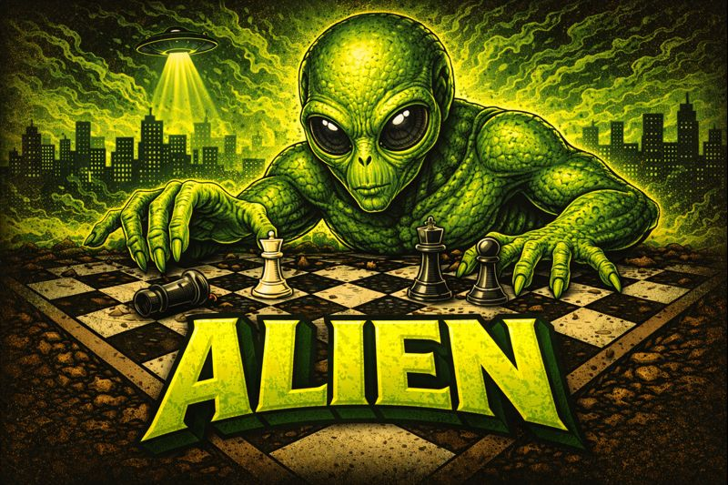

# Alien

     
     
    <b><i>Small uci chess engine 2600 elo.</i></b>
     
     
    
    
     
    
    

## Features

FIDE-rules-compliant chess engine

## Features

- Strength 2600 elo
- Single file
- Protocol UCI
- Board 8 reversible bitboards
- Evaluation 12 Piece Square Tables
- En passant
- Underpromotions (knight, bishop, rook)
- Threefold repetition
- 50-move rule
- Stalemate and checkmate reported correctly to the GUI